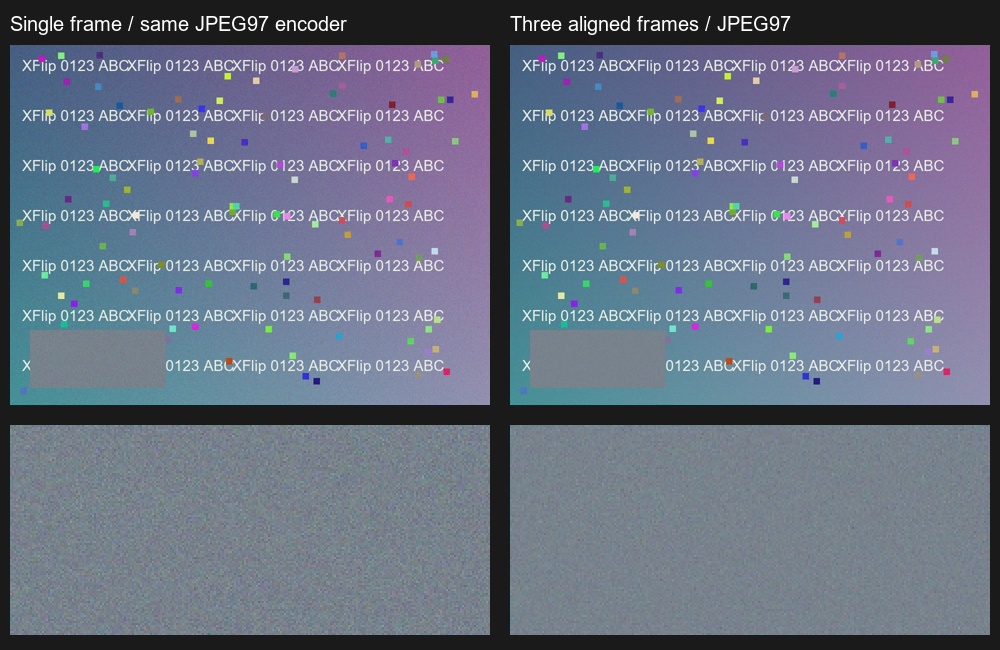

# 2026-10-15 三张 JPEG 多帧降噪与细节保留

基线 24628ae，版本 0.4.0-dev / 24。新增照片模式的实验性三张融合，实机安装包与工作者同版；保留此前重开重连、预览方向和独立原生功能键。

## 使用

在外屏左侧设置开启“连续三张合成：每张需确认”。拍第一张后点系统“确定”，应用自动进入第二张、第三张，右上显示 2/3、3/3。第三张确认后后台合成，保留全部原图并另存结果；启用文字水印时，再为合成图另存水印副本。录像不参与照片合成；取消或关闭设置会结束当前组，已经保存的原图保留。

这是三次真实照片回传，并非单次快门自动连拍。实机长按当前 IMAGE_CAPTURE 快门，系统明确提示“不支持连拍”；该公开入口一次只回传一个 JPEG。没有拿预览截图、同图复制或视频帧充当全分辨率照片。

## 实现与边界

- 官方 OpenCV 4.12.0：ORB/Hamming 比率匹配，RANSAC 估计近似相似变换，ECC 做亚像素精修。按较清晰参考帧对齐，拒绝特征不足、支持分布差、超出位移/旋转/缩放范围或严重模糊的候选。
- MultiFrameAccumulator 对参考帧赋权二、其他帧赋权一；8×8 局部亮度与残差检查加逐像素颜色门限，运动或不可靠区域保留参考，越界区域保持参考，不填黑边。轻度亮度锐化受噪声门限和局部过冲限制。
- 只处理三张不同文件、相同显示尺寸的 SDR JPEG，先归一 EXIF，最长支持 13,000,000 像素。本机实际 12.58MP 不降采样；只逐张解码、分块累加，复用 10-bit packed RGB 数组，避免同时持有三张全尺寸 Bitmap。输出保持参考帧尺寸和视角，JPEG 97，Orientation=1。
- 数据先完成再发布，复用 PendingMediaWrite；读取源文件只读，失败保留已发布原图。保留参考的真实 EXIF/GPS 白名单，并用 Software / ImageDescription 标明 JPEG 融合；水印副本保留融合描述。取消检查覆盖帧、分块和发布前，Activity 销毁会取消处理。
- 这属于已处理 JPEG 上的时域降噪及轻度锐化，不是 RAW HDR+、Google Camera 专有算法、神经网络补细节或超分辨率；不会修复所有失焦与运动模糊。光照或场景变化过大时宁可拒绝，实际收益取决于相机原有处理和拍摄稳定程度。

## 可复现质量检查

scripts/generate_photo_burst_fixture.py 生成已知几何、独立噪声、文字细节及运动块的合成输入，另存每帧无噪声参考。scripts/test_photo_burst_device.py 在实际应用 UID 调用同一生产 OpenCV/解码/融合/编码/发布流程，独立用 Pillow/NumPy 评价；合成测试输出在验证真实发布后由应用删除，原输入逐字节哈希不变。

为了区分重编码影响，单帧基准也在手机经相同 sRGB 解码和 JPEG 97 编码。最初对原始 JPEG 输入测得约 19% 的 MSE 比值包含重编码影响，最终以以下匹配基准为准，不把 19% 直接算作纯融合收益。

| 合成场景 | 有效帧 | 平坦区 MSE 比值，融合/同编码单帧 | 边缘对比度比值 | 手机处理耗时 |
| --- | --- | --- | --- | --- |
| 平移＋旋转＋独立噪声 | 3/3 | 0.3572 | 0.9918 | 1.361 秒 |
| 另有运动物体 | 3/3 | 0.3515 | 0.9940 | 1.236 秒 |
| 原始文件带 EXIF 6 | 3/3 | 0.3843 | 0.9936 | 1.278 秒 |

运动区域 MSE 比值 0.654，通过参考区域重影检查；不相关场景、完全重复文件和主动取消分别正确拒绝。六组都在真实 ARM64 手机上执行，输出尺寸、方向和原图哈希检查通过。以上数字仅限此 960×720 合成场景，不外推为真实照片普遍提升比例；边缘指标接近基准，主要成果是保细节降噪。

## 合盖全尺寸实拍

在左设置启用后，真实外屏先后完成三次快门与确认，第二、第三次右侧分别显示“拍照2/3”“拍照3/3”，实时方向保持正确。最后界面显示“多帧降噪增强已保存（3/3 有效帧），三张原图保留（含文字水印）”。预览服务在回传后正常退出。

- 原图三张：3,152,627 / 3,164,314 / 3,157,412 bytes，均 3072×4096，文件与像素可独立解码。
- 合成 JPEG：2,920,729 bytes，3072×4096，Orientation=1，ImageDescription 确认 accepted frames=3。
- 水印副本：2,345,862 bytes，3072×4096，Orientation=1，融合描述保留，机型与时间文字可见。
- 第三张系统缓存 JPEG 与图库原图 SHA256 相同；三张图库原图均仍存在。严格逐字节前后证明来自六组受控输入，实拍不冒称三张都有事前哈希。
- 真实场景无干净真值，不报告真实 PSNR 或保证清晰度提升；真实照片、视频、截图和 GPS 不公开。机器收据只保存尺寸、哈希和安全统计。

## 构建与交付

双 flavor assemble、各自 Lint、27,677 项核心断言、两套各 8 项 native graphics 水印测试及历史 JPEG 证据通过，BUILD SUCCESSFUL in 1m 19s。新增水印回归检查 ImageDescription，使融合来源能传到水印副本。核心独立噪声测试 MSE 比值 0.3802，运动像素维持参考。

本机为 arm64-v8a，256MB Java heap growth limit；APK 仅打包 ARM64 OpenCV 库，不宣称 x86 / 32 位支持。完整许可和实际依赖说明在 APK assets/licenses 与 docs/third-party-notices.md。

实测 APK 45,245,244 bytes，SHA256 `0165ad4b32d0b8a4dee322285997ddb57951d194ed7ec1f1768fc238c9e64328`，手机已安装 base.apk 与本地相同。仍需按 scripts/start_preview_bridge.ps1 初始化同版桥接；整机重启后的授权依赖沿用原限制。

[安全机器收据](evidence/multiframe-2026-10-15.json)。下一步优先减少三次确认的交互、扩展低照/运动/局部形变质量对照；不以增加帧数或锐化强度替代测量。
