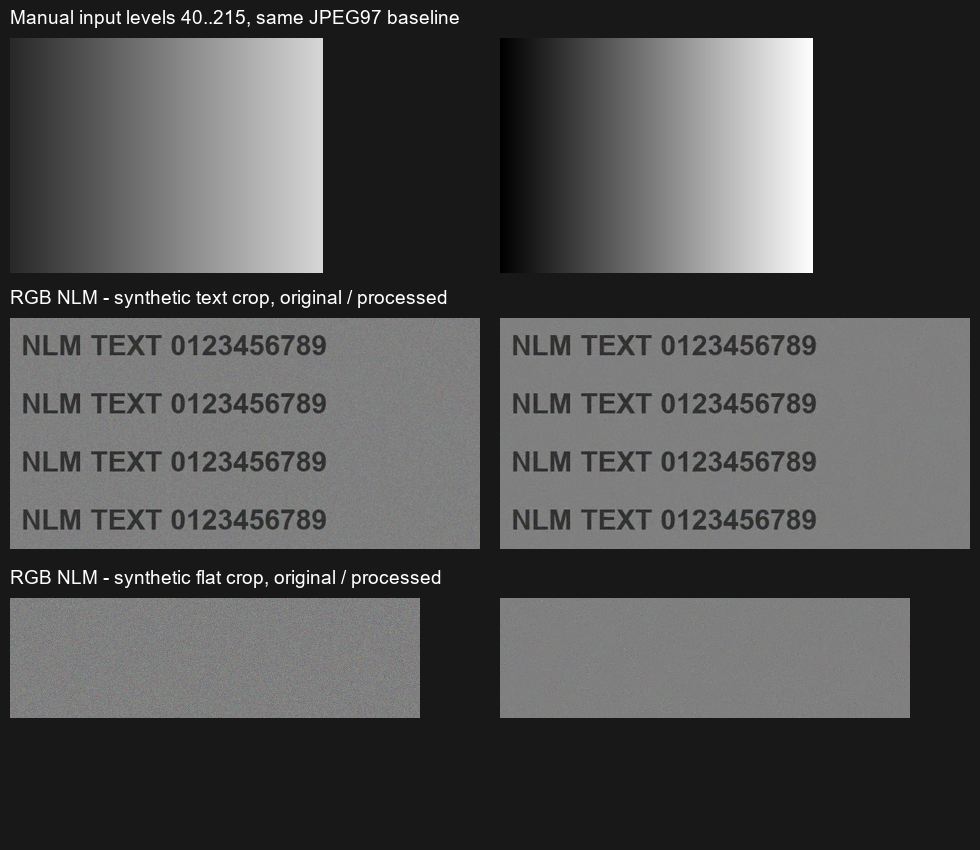

# 实时直方图、输入色阶与成熟降噪

基础版已先冻结在 [v0.4.2-basic](https://github.com/SturgeonIsSleepy/vivo-xflip-camera/releases/tag/v0.4.2-basic)，源码d8e4bb8。Release资产649227308为实际已安装APK的无损ZIP，18,414,835 bytes，摘要4b64257cd060768d5ffbfe4dac3e1644be25cd2220dcd221e545e9497c4ce3dc；手机与APK摘要一致。对应CI38992698267成功。此后的增强构建为独立包 `org.codeaurora.snapcam.lab`，名称“X Flip 影像实验”，不会覆盖手机的基础版。

## 操作和边界

增强版取景直方图默认显示，可在自有照片返回页的“取景直方图”开关关闭，下次进入取景生效。它在既有纠正预览内部绘制，不新增触摸窗口或覆盖系统按键；每500ms更新一次RGB综合采样。它反映屏幕取景图，不能当作传感器RAW曝光分布，也不与最终JPEG分布画等号。需要启用实时左右纠正桥接。

拍完确认后点“直方图/算法”。编辑器直接替换同一个SystemCaptureActivity的内容，不启动新Activity，避免vivo偶发FlipToContinue要求展开。显示RGB综合采样直方图，可隐藏；黑场/白场滑块严格保持0≤黑场＜白场≤255。按每个RGB通道将黑场及以下映射为0、白场及以上映射为255，范围内线性拉伸，直方图阴影和两条线表示裁切范围。这是参考[Adobe输入色阶语义](https://helpx.adobe.com/photoshop/desktop/adjust-color/color-corrections/adjust-levels-in-an-image.html)的RGB综合色阶，不是裁掉照片画幅或自动恢复过曝。

“原图”切换对照，“还原”回到无调整，“另存”处理完整尺寸并保留原图；关闭不生成编辑副本。预览最长边960，保存使用全尺寸，色阶公式相同；NLM/细节在不同分辨率的视觉效果可能不同，预览明确标注采样。编辑器每次从原始拍摄结果读取，不对先前副本反复累积调整。

## 算法及前两天成果对接

已将PhotoToneRowProcessor接入PhotoEnhancer，保持取消检查与原有行读取/写回。设备重新执行HDR和细节合成输入，与上版真实设备输出逐像素对照，最大通道误差均为0。原PendingMediaWrite的Error回滚与共享JPEG写入直接沿用；曝光元数据初筛保持只读、未接HDR采集，不把EXIF候选当真实包围曝光。

新增采用[OpenCV 4.12的fastNlMeansDenoising](https://docs.opencv.org/4.12.0/d1/d79/group__photo__denoise.html)成熟实现，直接处理8-bit RGB三通道，h=5、模板7、搜索21；不复制Google专有算法。512像素工作块、16像素重叠，只读取不变源图，避免前一块污染后一块。仍额外保留一份源Bitmap，未宣称整条流水线低内存优化。降噪先于输入色阶，既有受限细节/JPEG HDR色调在后，统一JPEG97另存与元数据/取消事务。

首个Lab色彩降噪候选在强色阶时暴露平滑面量化色带，最终改用直接RGB NLM，保留更多细粒度噪声而避免额外Lab往返。不能保证所有JPEG都有收益；系统已降噪的照片可能改善很小，也不能恢复缺失的文字纹理。NLM、细节和JPEG HDR色调在编辑器默认关闭，HDR仍非多曝光HDR或HDR+。

## 验证

核心944,181断言、双flavor各27项图形/保存/EXIF回归通过；最终lab构建/Lint通过。七组同生产算法的真实ARM64合成图检查通过：手动40–215映射0–255、RGB色块、无操作同编码像素一致、EXIF6方向、取消保留原始输入、NLM及13MP处理。NLM在固定960×720合成图的同编码基线下，MSE比0.36763，平坦噪声标准差比0.45942，文字边缘对比度比1.00011；有重叠块与独立整图OpenCV计算最大通道误差0。相同小图两轮save约1218/2415ms，最后整组测试含额外对照计算约5856ms，不能混同测试总耗时与单次保存，也不把一次运行当稳定速度。

固定3072×4096合成图的完整处理/保存约21807ms，说明13MP降噪仍较慢。作为拍后可选项，不能放进基础快门或宣传实时降噪。测试数据不代表真实场景通用收益或长期峰值内存。图像、数据均为独立合成，真实拍摄及其哈希/EXIF等标识不上传。

[公开软件/合成检查收据](evidence/editor-2026-10-17.json)。基线重启初始化、外屏助手、系统确认等限制仍保留；未扩展前摄/内屏/全旋转/长期耐久验收。

真实合盖还验证了直方图显示/关闭、原图对照、同窗口编辑、完整实拍另存与原始JPEG逐字节保留；最终安装包再完成一次色阶另存与NLM对照，未复现展开拦截。最终实验APK45,512,720bytes，SHA256 `89b8b4786b112df91057331c6885dd6424bcb3c09ecdf1c577c6337758d10f70` 与手机已安装包一致。七组合成检查后处理算法未再改变，后续为界面承载、实时直方图和保存提示修复；具体包校验与重跑范围见收据。手机最后恢复基础版桥接，实验版独立保留。
