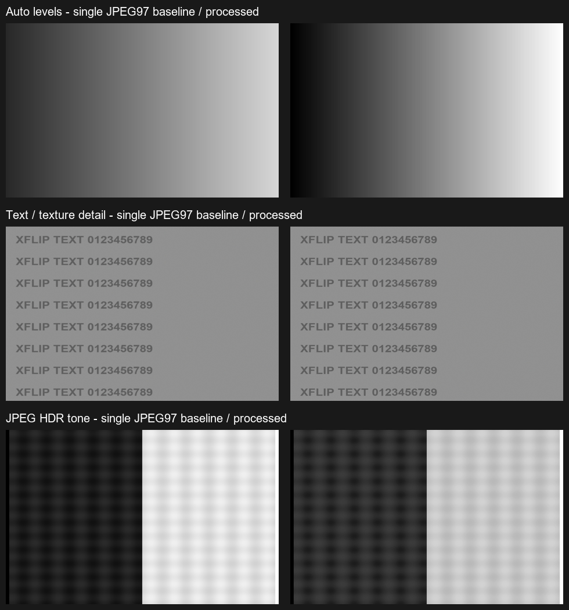

# 自动色阶、文字细节与 JPEG HDR 色调

基线 b77245a，最终版本 0.4.1-dev / 27。单张和三帧结果都支持，保留原图，在水印之前处理。

## 功能

自动色阶统计亮度直方图，去掉未占用的黑白端空白，不按百分比裁去已有尾部。通过方差和噪声估计，允许低对比文字扩展，避免纯噪声平面被拉满；已有完整范围则保持。

文字纹理使用限幅CLAHE和带噪声门限的亮度细节增强，局部过冲受限。RGB统一增益并受通道余量约束，避免饱和红等被提成白色；灰色保持中性。

JPEG HDR色调用双边对数亮度基础层压缩来平衡已记录的亮暗，保留局部细节。它是SDR JPEG色调映射，不是多曝光HDR采集、RAW HDR+、Ultra HDR gain-map，也无法恢复已经剪白或剪黑的内容。

自动色阶与细节默认开启，HDR色调默认关闭，左侧设置可分别开关。六项设置在实际外屏中可滚动，完成按钮始终可见。多帧在新的内存工作图上处理后再编码，单张另存处理副本，共用元数据、取消、单行发布/回滚；水印保留算法描述。未改变全机DPI或曝光权限。

## 验证

双flavor构建/Lint、30,437个核心断言、各8个水印原生图形回归及既有JPEG证据通过，最终构建41秒成功。核心覆盖色阶端点、已有尾部、低对比/平坦区别、灰阶、颜色比例、饱和色、光晕限制和HDR端点。

真实ARM64手机通过debug-only PhotoEnhancementDeviceTest执行同一生产算法，使用同Android sRGB/JPEG97单帧对照。以下均为独立生成的960×720合成图，不含私人照片：

| 合成场景 | 实测结果 |
| --- | --- |
| 自动色阶 | 40–215→0–255 |
| 低对比文字 | 90–149→约0–254 |
| 独立细节 | 文字边缘对比度比1.0994 |
| JPEG HDR色调 | 暗部均值29.24→45.08，亮部224.01→197.15，高光纹理标准差比0.8796，纯黑/白端点保持 |
| 平坦噪声 | 不拉伸，噪声MSE比1.0255 |
| 色块/灰块 | 主通道及中性检查通过 |
| EXIF6 | 归一方向与尺寸正确 |
| 取消 | 原输入哈希不变，无处理图发布 |

旧三帧同编码回归MSE比0.3572、边缘0.9918保持；拒绝、重复和取消亦检查。小图处理约1–2秒，不代表全尺寸耗时。这些不是对真实拍摄通用收益的承诺。

合盖实机还通过了设置操作、单张完整处理、三张融合加全部新处理、原图保留、水印保存和退出服务验证。实拍照片、哈希、文件名、EXIF及其他派生元数据只留本地，不公开；这组直方图已覆盖完整范围，自动色阶如设计保持。

APK为ARM64，45,261,656bytes，SHA256 `77a20167df57a47726902baf780bfc375ed08df5d23ba1990dd183e49c097cec`，手机已安装文件与本地一致。[公开收据只包含合成样本及软件检查](evidence/tone-2026-10-15.json)。手机重启初始化、系统每张确认和既有点击对焦等限制保留。

参考：[OpenCV CLAHE](https://docs.opencv.org/4.12.0/d6/db6/classcv_1_1CLAHE.html)、[Durand/Dorsey 基础层与细节层思路](https://people.csail.mit.edu/fredo/PUBLI/Siggraph2002/)。使用已有OpenCV双边滤波和自主色调代码，没有复制论文项目源码或Google专有算法。
